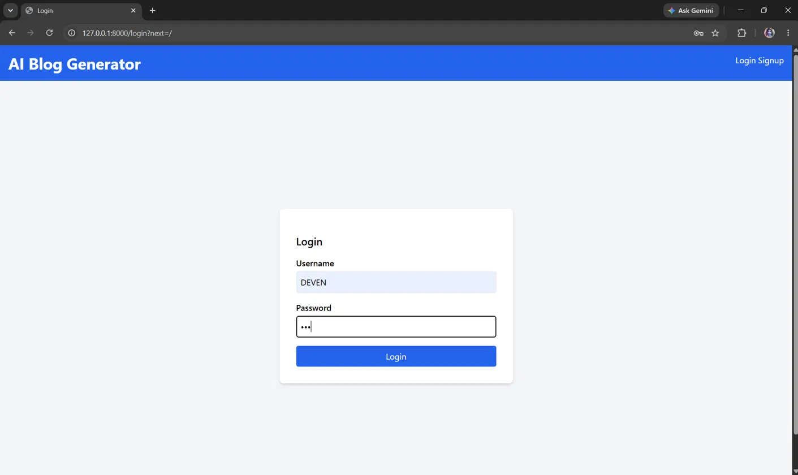
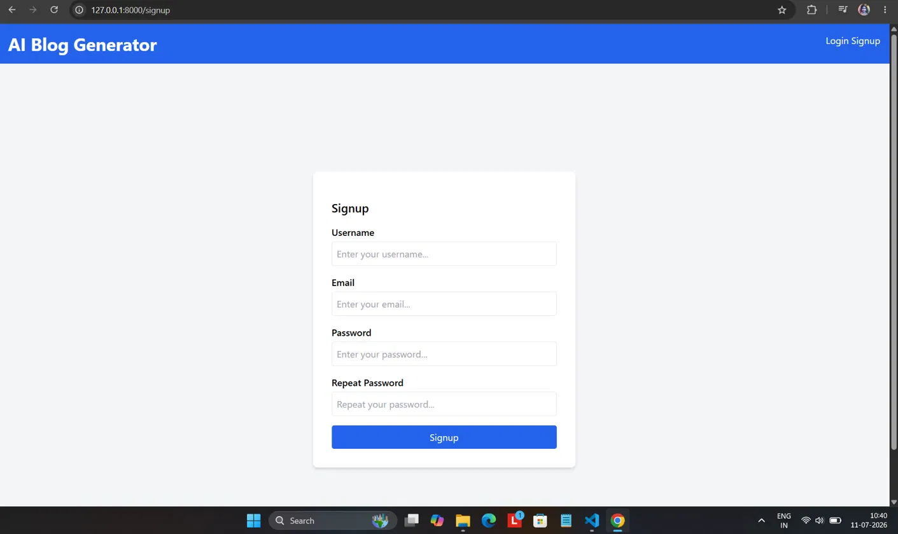
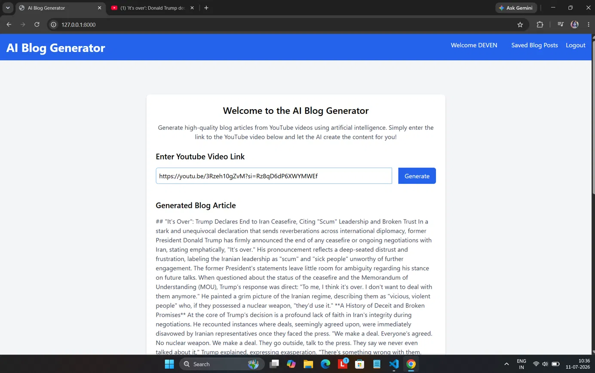
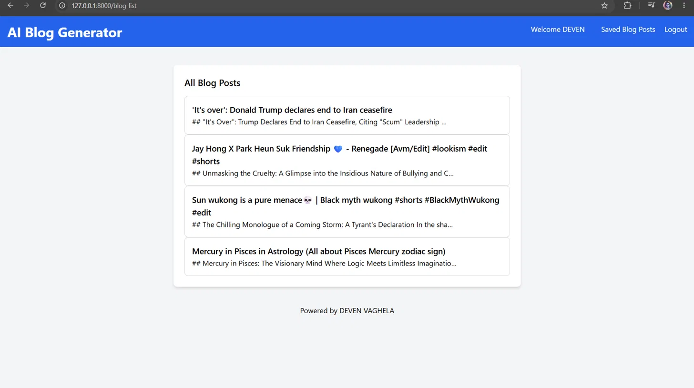
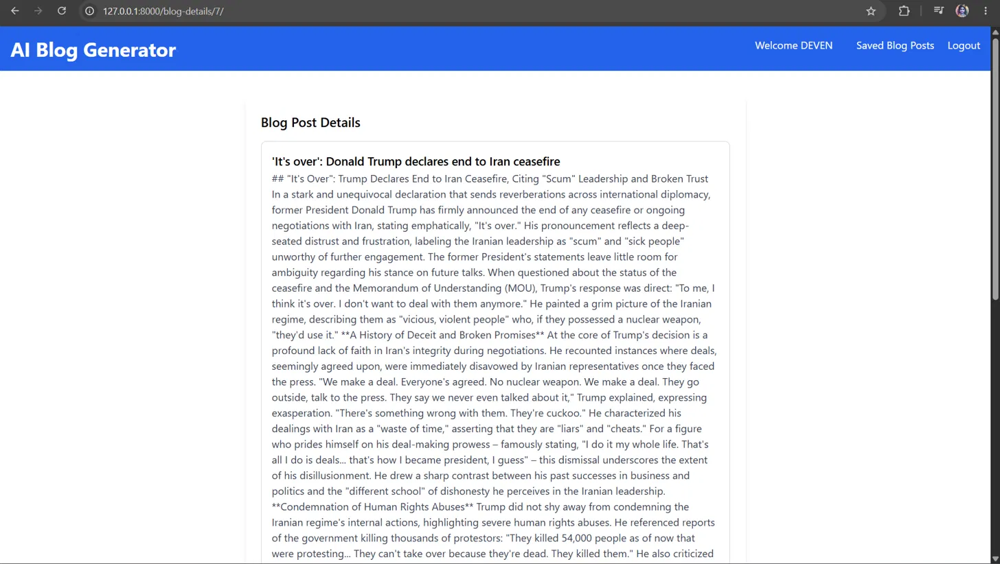
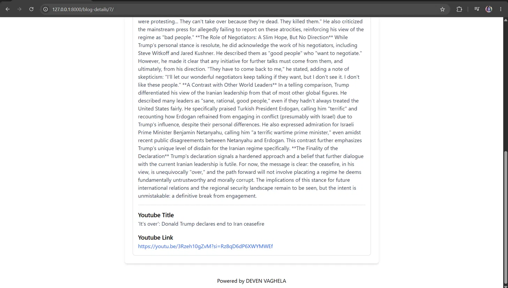

# AI Blog Generator

A Django web app that turns any YouTube video into a well-written blog article. Paste a video link, and the app downloads the audio, transcribes it, and uses AI to write a blog post that matches the tone of the video title. Generated posts are saved per user, so you can come back to them anytime.

## Features

- User signup, login and logout (Django authentication)
- Generate a blog article from a YouTube link
- Tone of the article adapts to the video title
- Saved blog posts list for each user
- Blog details page with the original video title and link
- Clean, responsive UI built with Tailwind CSS

## Tech Stack

| Layer | Technology |
|---|---|
| Backend | Python 3.13, Django |
| Database | PostgreSQL |
| Audio download | yt-dlp |
| Speech-to-text | AssemblyAI |
| Blog generation | Google Gemini 2.5 Flash |
| Frontend | HTML, Tailwind CSS, JavaScript |

## How It Works

1. The user logs in and pastes a YouTube video link.
2. The backend fetches the video title and downloads the audio using **yt-dlp**.
3. The audio is sent to **AssemblyAI**, which returns the transcript.
4. The transcript and the title are sent to **Gemini 2.5 Flash**, which writes the blog article.
5. The article is saved in **PostgreSQL** against the logged-in user and shown on the page.

## Screenshots

| Login | Signup |
|---|---|
|  |  |

**Home page: paste a link and get the generated article**



**Saved blog posts**



**Blog details**




## Project Structure

```
final django/
├── backend/
│   └── ai_blog_app/
│       ├── ai_blog_app/        # Django project settings and URLs
│       ├── blog_generator/     # App: views, models, URLs, migrations
│       ├── templates/          # HTML templates used by Django
│       └── manage.py
├── front/                      # Static HTML pages (frontend design)
├── screenshots/
├── requirements.txt
└── README.md
```

## Setup and Installation

### Prerequisites

- Python 3.13
- PostgreSQL (with pgAdmin, optional)
- An [AssemblyAI](https://www.assemblyai.com/) API key
- A [Google Gemini](https://aistudio.google.com/apikey) API key

### 1. Clone the repository

```bash
git clone https://github.com/devenvaghela57-cloud/ai-blog-generator.git
cd ai-blog-generator
```

### 2. Create a virtual environment and install dependencies

Using **uv**:

```bash
uv venv
.venv\Scripts\activate
uv pip install -r requirements.txt
```

Or using **pip**:

```bash
python -m venv .venv
.venv\Scripts\activate
pip install -r requirements.txt
```

### 3. Set up the PostgreSQL database

Create a database named `db` in PostgreSQL (using pgAdmin or `psql`):

```sql
CREATE DATABASE db;
```

### 4. Add your keys and database password

This repository contains placeholders instead of real secrets. Replace them with your own values:

| File | Placeholder | Replace with |
|---|---|---|
| `backend/ai_blog_app/blog_generator/views.py` | `YOUR_ASSEMBLYAI_API_KEY` | Your AssemblyAI API key |
| `backend/ai_blog_app/blog_generator/views.py` | `YOUR_GEMINI_API_KEY` | Your Gemini API key |
| `backend/ai_blog_app/ai_blog_app/settings.py` | `YOUR_DATABASE_PASSWORD` | Your PostgreSQL password |

Also check the `DATABASES` block in `settings.py` and make sure `HOST` and `PORT` match your PostgreSQL setup (the default PostgreSQL port is `5432`).

> Never commit real API keys or passwords to GitHub.

### 5. Run migrations and start the server

```bash
cd backend/ai_blog_app
python manage.py migrate
python manage.py runserver
```

Open http://127.0.0.1:8000 in your browser, sign up, and generate your first blog.

## Notes

- Generated audio files are stored temporarily in the `media/` folder, which is not part of the repository.
- YouTube changes its protections often. If downloads fail, update yt-dlp with `uv pip install -U yt-dlp` (or `pip install -U yt-dlp`).
- Very long videos take longer to transcribe and may hit API limits.

## Future Improvements

- Load API keys and database settings from environment variables
- Support for editing and deleting saved blog posts
- Export blogs as PDF or Markdown
- Language selection for blog output
- Deployment with Docker

## Author

**Deven Vaghela**
GitHub: [devenvaghela57-cloud](https://github.com/devenvaghela57-cloud)
